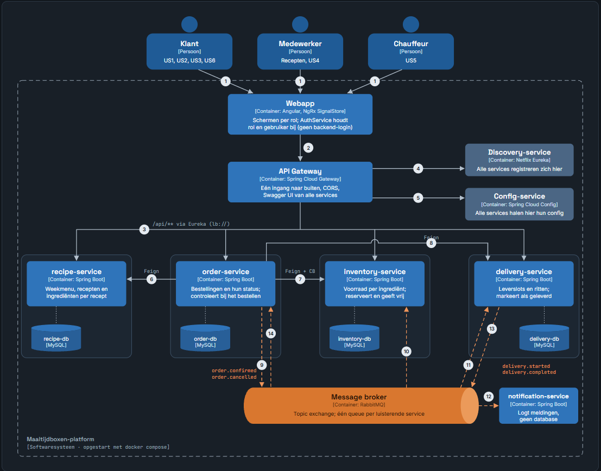

## Architectuur — C4 containerdiagram

Volle lijnen zijn synchroon, oranje stippellijnen gaan asynchroon via RabbitMQ. De nummers in het diagram verwijzen naar de tabel hieronder.

### Legende

| Element | Betekenis |
|---|---|
| Persoon (donkerblauw) | Een rol: KLANT, MEDEWERKER of CHAUFFEUR |
| Container (blauw) | Een applicatie die ik zelf bouw |
| Infrastructuur (grijsblauw) | Discovery-service en config-service |
| Message broker (oranje cilinder) | RabbitMQ, voor alle events |
| Database (cilinder) | Eén eigen MySQL-database per service, geen gedeelde tabellen |
| Kader | Een service samen met zijn eigen database |
| Volle lijn | Synchroon: de aanroeper wacht op het antwoord |
| Oranje stippellijn | Asynchroon: event via RabbitMQ, niemand wacht |

### Relaties

| # | Van → naar | Wat en waarom | Hoe |
|---|---|---|---|
| 1 | Personen → Webapp | Klant, Medewerker en Chauffeur werken in de browser. De rol wordt gekozen op het loginscherm. | HTTPS |
| 2 | Webapp → API Gateway | Alle REST-calls, met rol en gebruiker in de headers (via de authInterceptor). CORS wordt één keer op de gateway geregeld. | HTTP, JSON |
| 3 | API Gateway → services | Routeert `/api/recipes`, `/api/orders`, `/api/inventory` en `/api/deliveries` naar de juiste service. Een onbekend pad geeft 404. | HTTP, lb:// |
| 4 | Gateway (en alle services) → Discovery | Zoekt service-instanties op naam op, zodat er nergens `localhost`-URL's hardgecodeerd staan. | Eureka |
| 5 | Gateway (en alle services) → Config | Haalt bij het opstarten de configuratie op uit één centrale plaats. | HTTP |
| 6 | order → recipe | US2: haalt de ingrediënten en hoeveelheden van de gekozen recepten op, nodig om de voorraadbehoefte te berekenen. | Feign, synchroon |
| 7 | order → inventory | US2: is er genoeg voorraad? Zonder antwoord kan de bestelling niet aanvaard worden. Te weinig → 409. Circuit breaker met fallback: valt inventory uit, dan weigert de fallback de bestelling met een duidelijke fout in plaats van te blijven wachten. | Feign, synchroon, Resilience4j |
| 8 | order → delivery | US2: heeft het gekozen leverslot nog plaats? Vol → 409. | Feign, synchroon |
| 9 | order → broker | Publiceert `order.confirmed` (US2) en `order.cancelled` (US6). Wat daarna gebeurt, mag de bestelling niet meer doen mislukken. | AMQP, asynchroon |
| 10 | broker → inventory | `order.confirmed` → reserveert de ingrediënten. `order.cancelled` → geeft ze weer vrij (US6). | AMQP, asynchroon |
| 11 | broker → delivery | `order.confirmed` → plant de bestelling in een rit. `order.cancelled` → maakt de plaats in het slot weer vrij. | AMQP, asynchroon |
| 12 | broker → notification | Logt een melding voor de klant bij `order.confirmed`, `order.cancelled` en `delivery.completed`. Ligt deze service plat, dan slaagt de bestelling nog steeds. | AMQP, asynchroon |
| 13 | delivery → broker | US5: publiceert `delivery.started` als de rit vertrekt en `delivery.completed` als de chauffeur een bestelling als geleverd markeert. | AMQP, asynchroon |
| 14 | broker → order | US3: zet de status op `IN_DELIVERY` of `DELIVERED`. Zo weet order-service wat delivery gedaan heeft, zonder dat delivery de order-database aanraakt. | AMQP, asynchroon |

Elke service met data leest en schrijft alleen zijn eigen database (JPA). Micrometer Tracing geeft elke call en elk bericht dezelfde traceId mee, ook door de queue.

### Keuzes

- **order-service vraagt het zelf aan beide.** De ingrediënten per recept komen van recipe-service (6), de voorraad van inventory-service (7). Zo blijft inventory-service onafhankelijk van recipe-service.
- **Circuit breaker op de voorraadcontrole (7).** Valt inventory-service uit, dan weigert de fallback de bestelling met een duidelijke fout.
- **Events:** order-service publiceert `order.confirmed` en `order.cancelled`, delivery-service publiceert `delivery.started` en `delivery.completed`.
- **Geen extern mailsysteem.** notification-service logt alleen.
- **Vereenvoudiging:** bij het bestellen worden voorraad en slot alleen gecontroleerd (7, 8). Ze worden pas ingenomen bij `order.confirmed` (10, 11). Twee bestellingen op exact hetzelfde moment kunnen zo allebei de laatste plaats krijgen; in de praktijk is dat venster heel klein.
